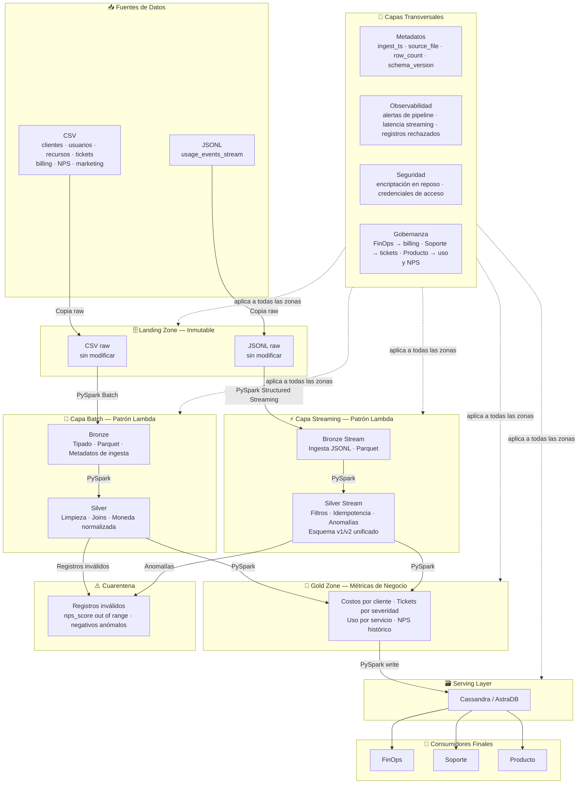

 # Documento de diseño — Cloud Provider Analytics

## 1. Interpretacion del problema
Somos del equipo de ciencia de datos de un proveedor de nube. Los datos de nuestros clientes (uso de servicios, facturación, tickets de soporte, etc.) llegan crudos, con errores, nulos y formatos inconsistentes. nuestro trabajo es limpiarlos, ordenarlos y transformarlos para que las tres áreas de la empresa:FinOps, Soporte y Producto, puedan usarlos sin complicaciones la  información  de forma clara, confiable y que sea fácil de consultar.

Hoy, mucha de esta información se arma de forma manual, lo que lleva tiempo y es propenso a errores. Con este proyecto buscamos que se pueda  automatizar ese proceso, combinando dos formas de entregar la información:

Un dashboard online, actualizado casi en tiempo real, para que el usuario pueda ver el día a día.
Informes diarios y mensuales, para análisis más consolidados.
Como objetivos concretos para saber si esto funcionó:
- Reducir el tiempo de generación de reportes de horas (proceso manual) a minutos (proceso automatizado).
- Reducir la tasa de registros inválidos por debajo del 5% del total procesado mediante reglas de calidad de datos.
- Tener la información disponible rápida y lista para usarla, tanto en el dashboard como en los reportes periódicos, en menos de 30 minutos desde que llegan los datos.
- Entregar métricas con una latencia máxima de 60 segundos desde la llegada del evento.

## 2. Justificación de la necesidad de Big Data mediante volumen, velocidad, variedad, veracidad y valor
### Volumen:
Por la cantidad de datos que se manejan.
Hoy el dataset tiene 80 organizaciones y en 60 días ya se acumularon 43.200 registros solo de eventos de uso, más tickets (1000), usuarios (800) y recursos (400). Pero en producción real serían miles de organizaciones, no 80, y cada una generando eventos todo el tiempo. Con  estos  datos actuales hay unos 9 eventos por organización por día, así que con 5.000 organizaciones serían unos 16 millones de eventos al año.

### Velocidad:
Por que la tabla mas pequeña es una tabla de refencia y la otra es de un historial o logeo.
Customers_orgs es una tabla de referencia  donde cada organización se registra una vez y cambia muy poco con el tiempo (80 filas fijas). En cambio, usage_events_stream es un historial/log de eventos que se genera constantemente, cada vez que un cliente usa un servicio y por eso en solo 60 días ya  se acumula 43.200 registros. Esta diferencia de frecuencia es justamente lo que justifica usar Structured Streaming para los eventos.

### Variedad:
Tenemos dos tipos de archivo: CSV y JSONL. Dentro de los archivos JSONL, según la versión  (schema_version), los eventos con versión 2 incluyen los campos carbon_kg y genai_tokens, mientras que los de versión 1 no los tienen (aparecen como nulos).

### Veracidad:
Se encontró fechas guardadas con formata objet donde panda lo toma  como string (texto),  aparte tenemos varias tablas con nulos significativos como por ejemplo la columna carbon_kg tiene el 25% de valores nulos de un totla de 43.200 eventos y con  valores fuera de rango cuando realice s el estudio de calidad de los datos y tambien se encontraron costos negativos.

### Valor:
En este proyecto buscamos convertir datos crudos y con errores en información clara y  con numeros en los que se puedan confiar para poder consultar. Por ejemplo, FinOps hoy tiene datos con nulos y valores negativos raros mezclados con los reales; una vez que el pipeline los limpia y los separa, FinOps puede confiar en los números que ve y detectar rápidamente ese problema real de costo, en vez de perder tiempo revisando si el dato está mal cargado o si es un problema genuino y para que el usuario tenga la informacion feaciente mas visible mas organizada.

## 3. Inventario y perfil inicial de las fuentes: grano, frecuencia, tipos, calidad, trazabilidad y riesgos.

### Cardinalidad y Grano

| Relación | Cardinalidad | Grano | Descripción |
|---|---|---|---|
| customers_orgs - users | 1:N | un usuario | Una organización puede tener muchos usuarios; un usuario pertenece a una sola organización. |
| customers_orgs - resources | 1:N | un recurso en la nube | Una organización puede tener muchos recursos; un recurso pertenece a una sola organización. |
| customers_orgs - support_tickets | 1:N | un ticket | Una organización puede tener muchos tickets; un ticket pertenece a una sola organización. |
| customers_orgs - marketing_touches | 1:N | una interacción de marketing | Una organización puede tener muchas interacciones de marketing; una interacción pertenece a una sola organización. |
| customers_orgs - nps_surveys | 1:N | una respuesta de encuesta | Una organización puede tener muchas respuestas de encuesta; una respuesta pertenece a una sola organización. |
| customers_orgs - billing_monthly | 1:N | una factura | Una organización puede tener muchas facturas; una factura pertenece a una sola organización. |
| customers_orgs - usage_events_stream | 1:N | un evento de uso | Una organización puede tener muchos eventos de uso; un evento pertenece a una sola organización. |
| resources - usage_events_stream | 1:N | un evento de uso | Un recurso puede tener muchos eventos de uso; un evento pertenece a un solo recurso. |

### Frecuencias

customers_orgs y users se crean una sola vez, porque una organización se registra una sola vez. Lo mismo  ocurre con un usuario: se da de alta una vez.

Resources, support_tickets, marketing_touches y nps_surveys se crean de vez en cuando porque consideramos que estos eventos pasan cuando algo puntual ocurre, sin un patrón fijo de tiempo. Un recurso se crea cuando el cliente decide mostrar algo nuevo, un ticket se abre cuando hay un problema, un touch de marketing pasa cuando el equipo decide hacer una campaña y las encuestas NPS se mandan esporádicamente, no en fechas fijas.

Billing_monthly ocurre de manera fija mensual porque hay un patrón regular y predecible: se genera exactamente una vez por mes. Lo vemos con los datos reales: 240 filas ÷ 80 organizaciones = 3 (una por cada uno de los 3 meses del dataset: junio, julio, agosto).

usage_events_stream es de forma continua porque a diferencia de todas las demás, no tiene pausas y se genera todo el tiempo, las 24 horas, cada vez que alguien usa un servicio en la nube. 

### Calidad

Las tablas tienen los siguientes problemas de calidad:

**Customers_orgs:** nulos en nps_score (13.75%), y un valor fuera de rango (101, cuando la escala NPS va de -100 a 100). La columna signup_date está guardada como texto en vez de datetime. Además, nps_score aparece también en Nps_surveys, lo que puede generar inconsistencias si los valores no están sincronizados.

**Users:** nulos en last_login (17.38%). Las columnas created_at y last_login están guardadas como texto en vez de datetime.

**Resources:** nulos en tags_json (20.75%). La columna created_at está guardada como texto en vez de datetime.

**Support_tickets:** nulos en resolved_at (24%) y csat (25.4%). Las columnas created_at y resolved_at están guardadas como texto. La columna csat usa una escala 0-7 poco habitual que conviene confirmar con la fuente.

**Marketing_touches:** sin problemas de nulos, pero la columna timestamp está guardada como texto en vez de datetime.

**Nps_surveys:** nulos en nps_score (20.65%) y comment (10.87%). La columna survey_date está guardada como texto en vez de datetime.

 **Billing_monthly:** nulos en credits (57.08%), y 13 facturas con subtotal negativo (el valor más bajo es -1671.83). Las facturas vienen en tres monedas (USD, ARS y EUR); la tabla incluye exchange_rate_to_usd para convertirlas, pero si no se aplica en la capa Silver las sumas quedan en monedas distintas y resultan incorrectas. La columna month está guardada como texto en vez de datetime.

**Usage_events_stream:** nulos en value (2.03%), unit (4.80%), carbon_kg (25%) y genai_tokens (92.75%); además costos negativos en cost_usd_increment. Los nulos de carbon_kg coinciden exactamente con los registros de schema_version = 1, lo que indica una evolución del esquema y no un error aleatorio. La columna value tiene tipo object en vez de numérico, lo que impide cálculos de consumo. La columna timestamp está guardada como texto en vez de datetime.

Ninguna tabla muestra filas duplicadas.

### Trazabilidad

**customers_orgs** es un archivo formato CSV y su clave única es org_id.Consideramos que es la tabla central; por ende todas las demás tablas se conectan a ella por ese ID.

**users** es un archivo formato CSV y su clave única es user_id, y se conecta con customers_orgs a través de org_id.

**resources** es un archivo formato CSV y su clave única es resource_id, y se conecta con customers_orgs a través de org_id.

**support_tickets** es un archivo formato CSV y su clave única es ticket_id, y se conecta con customers_orgs a través de org_id.

**marketing_touches** es un archivo formato CSV y su clave única es touch_id, y se conecta con customers_orgs a través de org_id.

**nps_surveys** es un archivo formato CSV y no tiene una clave única propia, por lo que se identifica cada encuesta con la combinación de org_id + survey_date,como clave compuesta, y se conecta con customers_orgs a través de org_id. Esto se debe a que si se usa solo org_id, la misma organización aparece varias veces y parecen datos repetidos; con survey_date, cada combinación es única y se puede identificar exactamente qué encuesta pretenece.

**billing_monthly** es un archivo formato CSV y su clave única es invoice_id, y se conecta con customers_orgs a través de org_id.

**usage_events_stream** es un archivo formato JSONL y su clave única es event_id, y se conecta con customers_orgs a través de org_id y con resources a través de resource_id.

### Riesgos identificados

#### Riesgo 1: Costos negativos en billing_monthly y usage_events_stream

El primer riesgo es en  billing_monthly donde encontramos 13 subtotales negativos, el más bajo de -1671.83. Estos valores probablemente no son errores, sino créditos del proveedor de nube, como devoluciones o ajustes por compromisos de uso. Si los eliminamos, el gasto neto mensual quedaría inflado y FinOps estaría tomando decisiones sobre números incorrectos. En los 13 registros negativos, el tax siempre es el 21% del valor absoluto del subtotal, un patrón que es compatible tanto con créditos como con un cambio de signo en el subtotal; en cambio, que el impuesto sea positivo cuando en una devolución real se esperaría negativo no apoya la hipótesis de crédito.
Ademas el README del dataset advierte que hay que esperar costos negativos y outliers como parte de la limpieza, por lo que no se puede descartar que alguna de estas facturas sea un error; por eso quedan marcadas para poder revisarlas.

En usage_events_stream encontramos cost_usd_increment con valores hasta -154.46. Acá lo consideramos una anomalía porque un recurso de nube no puede generar un consumo físico negativo.

#### Riesgo 2: Fechas guardadas como texto

En todas las tablas las fechas están guardadas como texto (tipo object en pandas). Esto significa que no se pueden hacer cálculos de tiempo, ordenar cronológicamente ni filtrar por rango de fechas correctamente. La mitigación es castear todas las columnas de fecha al tipo timestamp o date en la capa Bronze.

#### Riesgo 3: nps_score fuera de rango en customers_orgs

En customers_orgs encontré un nps_score con valor 101. El NPS válido va de -100 a 100, por lo que ese valor es imposible y distorsiona los promedios de satisfacción del cliente. Este registro se marca como outlier y se envía a quarantine.

## 4. Arquitectura de alto nivel

Los datos nacen como archivos en formato CSV y JSONL. Primero llegan a la zona de Landing sin modificarse. Después, usando PySpark, se procesan y llevan a Bronze, donde se les asigna el tipo de dato correcto y se agregan metadatos de ingesta. Luego pasan a Silver, donde se realiza la limpieza: se arreglan los nulos, se unen las tablas y se unifica el esquema v1/v2. En Gold se calculan las métricas finales (costos, tickets, uso) para cada dominio de negocio. Finalmente, los datos se cargan en Cassandra/AstraDB, donde los usuarios de las tres áreas de negocios pueden consultarlos.

## 5. Patrón arquitectónico

Elegimos el patrón Lambda porque es un modelo diseñado para procesar datos combinando dos capas: una capa de velocidad, que procesa datos en tiempo real (streaming), y una capa de lotes (batch), que procesa grandes volúmenes de datos en intervalos de tiempo predefinidos. El proyecto tiene  dos caminos de procesamiento: uno para datos que llegan periódicamente (batch) y otro para datos que llegan en tiempo real (streaming):donde la fuente usage_events_stream requiere procesamiento en tiempo real (streaming), mientras que billing_monthly, support_tickets, customers_orgs, users, resources, nps_surveys y marketing_touches son datos periódicos que se procesan en lotes (batch). En nuestra modelo de arquitectura que proponemos, ambas capas se construyen con PySpark: la capa de lotes mediante procesamiento batch estándar, y la capa de velocidad mediante Structured Streaming.

Ademas consideramos que Kappa no aplica porque solo utiliza procesamiento en tiempo real (streaming), con un único camino para todos los datos, y no es adecuado para datos maestros y periódicos como los que tiene este proyecto. 
Luego para la capa de presentacion del cliente todos los datos  convergen en la zona Gold, desde donde se cargan a Cassandra para su consumo.

## 6. Matriz requisito-componente

| Requisitos a tener en cuenta  | Herramienta que utiliza  | Zona que se encuentra  |justificación de la necesidad de Big Data: Volumen, velocidad, variedad, veracidad y valor |
|---|---|---|---|
| Ingestar  las tablas CSVs periódicamente | PySpark Batch | Bronze | Volumen, Variedad |
| Ingestar JSONL en tiempo real | PySpark Structured Streaming | Bronze | Velocidad |
| conservar datos crudos sin modificar | Copia directa | Landing | Veracidad |
| Clasificar los campos y agregar metadatos de ingesta | PySpark | Bronze | Veracidad |
| Limpiar nulos, joins y normalizar moneda | PySpark Batch | Silver | Veracidad |
| Unificar schema v1/v2 | PySpark Streaming |Silver Stream | Variedad |
| Costos y facturación por organización y servicio | PySpark Batch | Gold | Valor |
| Volumen de tickets, SLA y CSAT por org | PySpark Batch | Gold | Valor |
| Uso, requests y genai_tokens por servicio | PySpark Structured Streaming | Gold | Valor |
| Quarantine de registros inválidos | PySpark | Cuarentena | Veracidad |
| re-ejecución sin duplicados | PySpark Structured Streaming | Silver Stream | Veracidad |
| disponiblizar consultas por dominio | Cassandra/AstraDB | Serving Layer | Valor |

## 7. Diseño del Data Lake
El Data Lake se organiza en cinco zonas: Landing, Bronze, Silver y Gold como zonas progresivas, y Quarantine para los registros inválidos.

En landing se guardan los datos como están, sin modificarse. Bronze toma esos datos y los tipifica, agregamos columnas extra para saber cuándo y de dónde vinieron, como por ejemplo ingest_ts y source_file.

En Silver limpiamos los datos: se sacan los duplicados si tienen, se arreglan los nulos. 
Por último, en Gold se producen las métricas finales para que los usuarios de FinOps, Soporte y Producto puedan consultarlas.

Los archivos en Bronze, Silver y Gold se guardan en formato Parquet en vez de CSV porque se guardan los datos por columnas y comprimidos. Si PySpark necesita solo algunos de esos datos, lee solo la columna y no el archivo completo. En el proyecto tenemos 43.200 eventos y múltiples tablas, y con esto lo podemos hacer más rápido y que ocupe menos espacio.

Los eventos de uso consideramos que se organicen por year/month. debido a que con las 80 organizaciones del dataset, particionar también por org_id generaría 160 carpetas de unas 264 filas cada una, con muchos archivos pequeños. Con año y mes quedan solo 2 carpetas, de 20.880 y 22.320 eventos, y PySpark sigue aplicando partition pruning, es decir que no lee todo el dataset cuando se filtra por período. Las consultas por organización las resuelve Cassandra/AstraDB en la capa de serving. Las tablas CSV (clientes, usuarios, recursos, tickets, marketing, NPS y billing) no se particionan, porque tienen entre 80 y 1.500 filas.

Para que un registro pase de una zona a la siguiente se aplican estas reglas: de Landing a Bronze, el archivo tiene que poder leerse sin errores; si está corrupto no se ingesta. De Bronze a Silver, el registro tiene que tener los tipos de dato correctos y las columnas de metadatos:ingest_ts, source_file; si no cumple va a Quarantine. De Silver a Gold, el registro tiene que estar limpio: nulos tratados, moneda normalizada y joins aplicados; si no cumple va a Quarantine. De Gold a Cassandra, las métricas no pueden tener nulos en los campos clave.

Luego en Quarantine se guarda el registro original sin modificar, junto con los metadatos ingest_ts y source_file y una columna con el motivo del rechazo . De esa forma el equipo puede revisar cada caso durante los 90 días de retención antes del descarte definitivo.

En Landing los datos se conservan 30 días, ya que una vez ingeridos en Bronze los archivos crudos no son necesarios; si hay que reprocesar, Bronze es el punto de partida. En Bronze y Silver se mantiene una retención de 1 año, lo que permite reprocesar desde Bronze ante errores en la lógica de transformación o recalcular métricas de Gold sin volver a la capa de limpieza. En Gold los datos se conservan indefinidamente, dado que son las métricas de negocio consultadas continuamente por las tres áreas. En Quarantine la retención es de 90 días, que es el período disponible para revisión manual antes del descarte definitivo.

## 8. Flujo batch y streaming

### 8.1 Flujo Batch (Tablas en formato CSV)

1. Los datos nacen como archivos CSV: clientes, usuarios, recursos, tickets, billing, NPS y marketing.
2. Esos archivos se copian tal cual a Landing, sin modificarse nada.
3. PySpark Batch los lee de Landing, les pone el tipo de dato correcto, agrega las columnas `ingest_ts` y `source_file`, y los guarda en Parquet en Bronze.
4. PySpark toma lo de Bronze, lo lleva a Silver y ahí saca duplicados si las tablas lo tienen, arregla nulos, une tablas y normaliza la moneda a USD. Los registros inválidos se envían a Cuarentena.
5. PySpark toma lo de Silver, calcula las métricas de negocio y las guarda en Gold.
6. Desde Gold, PySpark escribe los resultados en Cassandra/AstraDB.

### 8.2 Flujo Streaming (Datos en tiempo real)

1. Los eventos de uso llegan continuamente como archivos JSONL.
2. Se copian tal cual a Landing.
3. PySpark Structured Streaming los lee en tiempo real, tipifica, agrega `ingest_ts` y `source_file`, y guarda en Parquet en Bronze Stream.
4. En Bronze, el stream deduplica por event_id para no guardar dos veces el mismo evento. Los eventos que llegan dentro del watermark siempre se procesan; los que llegan después pueden descartarse. Por eso ordenamos los eventos por timestamp antes de enviarlos: por que cuando realizamos una prueba con los archivos desordenados solo pasó el 1,7 % de los eventos, y con los archivos ordenados pasaron los 43.200. Después en un segundo stream: que es Silver Stream lee desde Bronze, aplica filtros y detecta anomalías, y las envía a Cuarentena.
5. Desde Silver Stream converge con el camino batch en Gold.
6. Desde Gold se escribe en Cassandra/AstraDB.

Para el streaming definimos un watermark de 10 minutos sobre el campo timestamp de usage_events_stream.Donde el watermark le dice a Spark hasta cuándo esperar eventos que llegan tarde: si el último evento procesado tiene timestamp 10:00, todavía acepta eventos hasta las 9:50, y los que llegan después de eso los descarta.

Por que al explorar los datos vimos que los 120 archivo no están ordenados cronológicamente: Dado que cada archivo abarca casi todo el rango, del 03/07/2025 al 31/08/2025. Si los procesáramos en el orden en que están, de a un archivo por vez, cerca del 98 % de los eventos se marcaría como tardío y el stream quedaría casi vacío. Por eso ordenamos los eventos por timestamp y los enviamos en ese orden.

Elegimos 10 minutos como decisión de diseño para  que el sistema tenga una funcion continua, donde los eventos llegarían casi en orden y con poca demora. Es un valor intermedio: por  lo que es bastante amplio para aceptar eventos que llegan apenas tarde, y lo bastante corto para que Spark no acumule estado de más. Con 1 hora guardaría en memoria eventos de la última hora sin necesidad, y con 1 minuto correríamos el riesgo de descartar eventos válidos que llegaron un poco tarde. Como el dataset no permite medir el retraso real de llegada, este valor se ajustará en la implementación si hace falta.

## 9. Flujo MapReduce de referencia

En la etapa Map, PySpark distribuye los registros de las fuentes de datos entre los nodos del cluster. Cada nodo procesa su parte y formula los pares clave-valor, en el proyecto se tienen los siguientes casos:
billing_monthly → (org_id, (subtotal - COALESCE(credits, 0)) × exchange_rate_to_usd)
support_tickets → (org_id, 1)
usage_events_stream → (org_id + service + metric, value)
usage_events_stream (solo service = "genai") → (org_id, genai_tokens)
En donde cada nodo del cluster procesa una parte de esos archivos en paralelo.

Luego en Shuffle: PySpark redistribuye los pares por clave y todos los registros de la misma organización se juntan en el mismo nodo.

Por último en Reduce: PySpark agrega los valores agrupados y produce las métricas y los resultados se escriben en Gold y luego en Cassandra.

### Caso desarrollado: billing_monthly

En billing_monthly tenemos facturas en distintas monedas: USD, ARS, EUR. Para saber cuánto gastó cada organización en total, PySpark hace lo siguiente:

Map: lee cada factura, descuenta los créditos, donde si credits es nulo vale 0 y multiplica el resultado por el tipo de cambio para convertirlo a USD. El resultado es un par:org_id, monto_en_usd. Como ejemplo tenemos que org_xaji0y6d tiene 3 facturas. Las tres se multiplican por su exchange_rate_to_usd, incluso las de USD, porque su tasa no es exactamente 1.0: 1133.34 × 0.97684 = 1107.09 USD y 619.17 × 1.00331 = 621.22 USD. La tercera viene en ARS: 540.79 × 0.00160 = 0.87 USD.

Shuffle: junta todas las facturas de org_xaji0y6d en un mismo nodo, todas las de org_pbhsahxt en otro, etc.

Reduce: suma todos los montos de cada organización. ya que org_xaji0y6d tenía tres facturas: 1107.09 USD + 621.22 USD + 0.87 USD = 1729.18 USD total.

Grano final: al terminar tenemos una sola fila por organización con su costo total en USD.

Validación: Por lo que total_usd no puede ser nulo. Dado a que no se puede verificar sumando los subtotales originales porque están en monedas distintas. Para validar se recalcula fila por fila: (subtotal - COALESCE(credits, 0)) × exchange_rate_to_usd, y se verifica que el resultado coincida con el total_usd que produjo el Reduce. Además se controla que ninguna tasa sea nula o cero.

## 10. Supuestos y riesgos
### Supuestos

Se asume que solamente existen dos versiones de schema (v1 y v2) y no habra una tercera versión; esta arquitectura solo sirve para estas dos versiones.

Se asume que el campo exchange_rate_to_usd existe en la tabla billing_monthly y es mayor a cero.

Se asume que para poder unir con joins distintas tablas es necesario tener un campo en común entre ellas, en este caso org_id.

### Riesgos
El diseño actual no contempla corregir datos en cuarentena, ya que se los separa para no contaminar; caso contrario los datos serían inconsistentes.

El campo credits tiene un 57% de valores nulos. Se definió que si credits es nulo se trata como 0 en la fórmula del Map, de forma que el total siempre tiene un número válido. Esto puede afectar los resultados en Gold.

Si aparece una versión 3 del schema, se tendrá que volver a modificar las capas para poder limpiar y mostrar los datos, es decir que se tendría que tocar todo el proceso.

Con la partición por year/month, los 43.200 eventos quedan en 2 carpetas de 20.880 y 22.320 eventos, así que el volumen actual no genera archivos pequeños por la partición. El riesgo sigue existiendo en el streaming, porque cada micro-lote escribe archivos chicos, y si más adelante se agregara org_id como partición, cada carpeta tendría unas 264 filas y Spark tendría que abrir y cerrar muchos archivos chicos que no aportan nada al cálculo.

## Mitigación de los Riesgos

Para el riesgo 1 tomamos que  la mitigación habitual es generar un reporte o log con los registros rechazados, para que alguien del equipo pueda revisarlos manualmente y decidir si corregirlos o descartarlos definitivamente.

Para el riesgo  de credits con el 57% de nulos, la mitigación  considerada  es tratar credits nulo como 0 en la fórmula del Map: (subtotal - COALESCE(credits, 0)) × exchange_rate_to_usd. Así Gold siempre recibe un número válido. Esta decisión está pendiente de confirmar con FinOps.

Como mitigación del riesgo 3, se podría agregar una capa que funcione como interfaz común a todas las versiones, de forma que al aparecer una nueva versión solo sea necesario modificar esa capa y no todo el proceso.

Por ultimo para el riesgo de archivos pequeños, se consideraron dos frentes: por un lado tenemos el crecimiento del sistema en producción, más organizaciones y más meses de datos donde cada partición va a acumular muchos más eventos y los archivos van a ser más grandes; y  por otro lado, se aplica coalesce() antes de escribir cada partición en Parquet para consolidar los archivos pequeños en uno solo, reduciendo el tiempo que Spark gasta abriendo y cerrando archivos innecesariamente.

## 11. Estimación preliminar
Esta sección tiene tres cosas: los roles del equipo, el tiempo estimado para cada tarea, y el esfuerzo total.

### Roles

Analista de negocio

Data Engineer

Data Analyst

QA / Tester

### Cronograma estimado del proyecto 

- En primera instancia tenemos la exploración de datos,  que estara a cargo del Data Analyst, con una duración estimada  de 4 días.

- Diseño de arquitectura, a cargo del Analista de negocio y el Data Engineer, con una duración estimada de 4 días.

- Desarrollo del pipeline batch, a cargo del Data Engineer, con una duración estimada de 2 semanas.

- Desarrollo del pipeline streaming, a cargo del Data Engineer, con una duración estimada de 2 semanas.

- Se carga en Cassandra, a cargo del Data Engineer, con una duración estimada de 1 semana.

- Testing y QA, a cargo del QA / Tester, con una duración estimada de 1 semana.

### Esfuerzo
El esfuerzo total estimado para este proyecto es de aproximadamente 8 semanas.

### Próximos pasos a seguir

Los siguientes pasos a tomar para la segunda etapa es avanzar sobre la implementación concreta del pipeline diseñado en esta primera instancia del proyecto, siguiendo el flujo definido ya en la arquitectura:

Pipeline batch: donde se cargan los archivos CSV hacia Landing Zone, para procesarlos con PySpark y se genera la capa Bronze en formato Parquet con metadatos de carga, y así poder aplicar las transformaciones de limpieza, joins y normalización de moneda en Silver.

Pipeline streaming:  se configura PySpark Structured Streaming para la ingesta continua de los archivos JSONL, para  garantizar un re-procesamiento seguro  y aplicando los filtros de calidad definidos en Silver Stream.

Construir la capa Gold: se generan las métricas de negocio a partir de los datos ya procesados en Silver Batch y Silver Stream, incluyendo los costos por organización, volumen de tickets y uso de servicios, etc.

Carga en Cassandra/AstraDB y validacion del pipeline: se vuelcan los datasets de Gold en la base de datos y se verifica que las tres areas (FinOps, Soporte y Producto) puedan consultar sus métricas.

## Alcance de la etapa 2 y lo que queda para la entrega final

En esta etapa implementamos el recorrido completo para  el uso de servicios de la nube. Ingestamos tres maestros en Bronze (customers_orgs, users y billing_monthly) con esquema explícito, deduplicación por clave y las columnas ingest_ts y source_file. Donde los eventos de usage_events_stream los procesamos con Structured Streaming, lo que nos permitio leer un archivo por vez y simular la llegada continua de eventos en micro-lotes. Definimos  tambien el esquema de cada columna antes de leer, aplicamos un watermark de 10 minutos para descartar los eventos que llegan demasiado tarde, eliminamos los eventos repetidos por event_id y usamos un checkpoint para que Spark recuerde qué archivos ya procesó. Probamos dos casos: con los archivos desordenados se descartaba el 98,3 % de los eventos por tardíos, por lo cual decidimos ordenarlos por timestamp antes de enviarlos; y al volver a ejecutar el proceso, o al recibir un archivo repetido, la cantidad se mantuvo en 43.200 eventos, sin duplicados. Todas las capas se guardan en formato Parquet, y los eventos se separan en una carpeta por mes:(year/month).

En Silver limpiamos los eventos y los unimos con customers_orgs. Aplicamos reglas de calidad: los eventos sin event_id o con costo menor a -0,01 van a Quarantine  y la unidad vacía se completa y se marca con unit_imputed. Además calculamos las features requests, cpu_hours y storage_gb_hours a partir de la métrica de cada evento.

En Gold armamos el mart org_daily_usage_by_service, con grano diario por organización y servicio, y las métricas daily_cost_usd, requests, cpu_hours, storage_gb_hours, genai_tokens y carbon_kg. Lo cargamos en Cassandra/AstraDB y ejecutamos dos consultas CQL: costos y requests diarios de una organización en un rango de fechas, y servicios con más costo en los últimos 14 días.

Quedan para la entrega final las demás tablas (resources, support_tickets, marketing_touches y nps_surveys), la limpieza de los maestros en Silver (incluida la conversión de moneda a USD y el NPS inválido), el cálculo de billing de la sección 9 y los marts de tickets, NPS, revenue y tokens de GenAI. También queda pendiente el componente analítico: vamos a detectar anomalías de costo con z-score sobre daily_cost_usd por organización y servicio, y guardar el resultado en un mart de anomalías de costo. Todo eso forma parte del diseño, pero todavía no está implementado.

